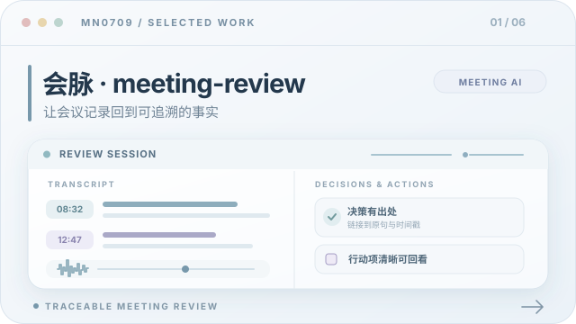
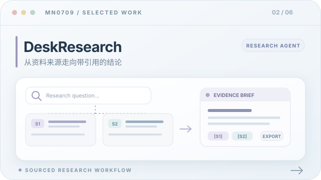
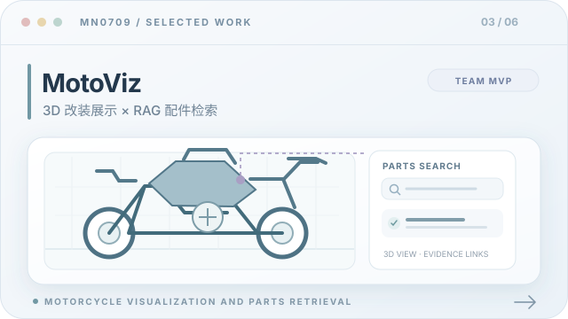
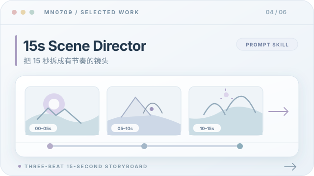
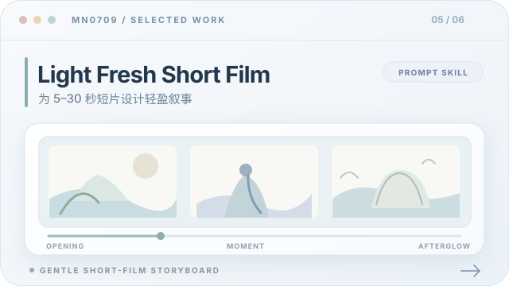
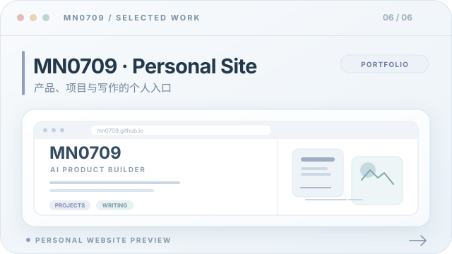

# 你好，我是马宁 👋

  

点击上方工作台，打开我的个人网站

  🌐 <a href="https://mn0709.github.io/">个人网站</a> · 🧩 <a href="https://github.com/MN0709?tab=repositories">开源项目</a> · ✍️ <a href="./ARTICLES.md">全部文章</a> · ✉️ <a href="mailto:mini.ning9900@gmail.com">邮箱</a>

---

## ⭐ 精选项目

我关注真实任务中的 AI 产品：先弄清问题，再做可验证的工作流，最后用证据决定下一步。

  
  

  
  

  
  

其中 [MotoViz](https://github.com/MN0709/MotoViz) 是团队 MVP；我负责 RAG 方向的协调、检索工作与交付验收。

---

## ✍️ 写作

记录 AI 产品、Agent 工作流与创作实践。这里先展示六篇文章。

- [AI 短片为什么总拍出“廉价感”？从一个开源提示词 Skill 说起](https://mp.weixin.qq.com/s/uZz9UYeea2hLUhraux4-jw) *(Chinese)*
- [AI视频提示词总翻车？这个15秒电影感Skill，免费送](https://mp.weixin.qq.com/s/WKaOWsEiCgC_4gpqy7PQqA) *(Chinese)*
- [AI 出图没有故事感？问题出在提示词里没有“导演”](https://mp.weixin.qq.com/s/oyRt9fqH-uVuAhnrBbwpgQ) *(Chinese)*
- [AI生图一出手就露馅？问题不在模型，在你写的提示词](https://mp.weixin.qq.com/s/JzZGPTQE_XgYOK3Pa73n_A) *(Chinese)*
- [每天省回 3 小时：他把「刷 X 找选题」整个外包给了 Grok](https://mp.weixin.qq.com/s/iFhSuHmabYDnM0LQNDPglQ) *(Chinese)*
- [50 个 Agent 一个月烧掉 $48,600：它们死于“衰老”，不是模型不行](https://mp.weixin.qq.com/s/RbJfMZOdl1smIzcddewcQw) *(Chinese)*

[查看全部文章 →](./ARTICLES.md)

---

## 关于我

- AI 产品经理，关注 Agent 工作流与可落地的 AI 产品。
- 从用户问题出发，做范围明确、可以试用的原型。
- 用真实结果、反馈和评测，检查产品是否完成了任务。

问题 → 工作流 → 验证 → 迭代
