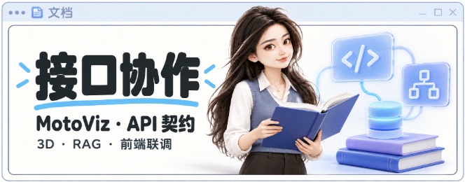

# 你好，我是马宁 👋

  

点击上方工作台，打开我的个人网站

  🌐 <a href="https://mn0709.github.io/">个人网站</a> · 🧩 <a href="https://github.com/MN0709?tab=repositories">开源项目</a> · ✍️ <a href="./ARTICLES.md">全部文章</a> · ✉️ <a href="mailto:mini.ning9900@gmail.com">邮箱</a>

---

## ⭐ 精选项目

  
  

  
  

  

产品梦工厂 · AI 协作、项目文件与模型对比

<strong>更多精选项目</strong>

- [个人网站](https://mn0709.github.io/)
- [浏览全部公开仓库](https://github.com/MN0709?tab=repositories)

MotoViz 是团队 MVP，我负责 RAG 方向的协调、检索工作与交付验收。悬浮岛的功能与源码见[仓库说明](https://github.com/MN0709/xuanfudao)。

## 📚 知识文档

  
  

<strong>更多知识文档</strong>

- [AI 产品开发工作台](https://github.com/MN0709/ai-product-starter-kit)
- [全部文章](./ARTICLES.md)

会脉产品规格 V1 是早期团队定位文档；项目当前定位与进展请以[会脉仓库首页](https://github.com/MN0709/meeting-review)为准。

## 🧰 Skills

  
  

<strong>更多 Skills</strong>

- [每日工作复盘与次日任务规划](https://github.com/MN0709/Daily-Work-Summary)
- [中文写作与去 AI 味改稿](https://github.com/MN0709/deai-human-writing)

---
